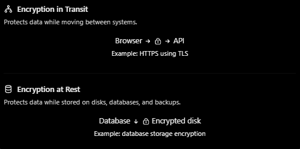

### 1. What is Encryption at Rest?
Imagine our application stores user information in PostgreSQL.

```
User
  |
  v
Express.js API
  |
  v
PostgreSQL
  |
  v
Disk / Backups
```

Suppose an attacker obtain a copy of the db files or a backup.

With encryption at rest:
```
Database files on disk
          |
          v
   Encrypted data
          |
          v
Requires authorized access
to the encryption key
```
The data is stored in encrypted form and must be decrypted by an authorized component before it can be used.

Examples of data to protect include:
- User personal information
- Payment related record
- Session or token data
- Uploaded documents
- Database files and backups
- Logs containing sensitive information

### 2. Encryption in Transit vs Encryption at Rest



# Data Protection: In Transit vs At Rest

| Property        | In transit                          | At rest                                      |
|-----------------|-------------------------------------|----------------------------------------------|
| Protects        | Network communication               | Stored data                                  |
| Common mechanism| TLS                                 | AES-based encryption                         |
| Example         | Browser → API                       | Database disk and backup                     |
| Main threat     | Network interception                | Storage theft or unauthorized file access    |


### 3. How does encryption at rest work?

```
Plaintext data
      |
      v
Encryption algorithm + key
      |
      v
Ciphertext stored on disk
      |
      v
Authorized decryption
      |
      v
Original data
```

### 4. Where should encryption happen?

There are several common approaches:
A. Disk or volume encryption
B. Database or managed service encryption
C. Application level encryption

### 5. Key management - the most important part

Encryption is only as secure as the protection of its keys.
Bad architecture

```
Application
   |
   ├── Database credentials
   └── Encryption key hardcoded in source code
```

A better architecture:

```
               Key Management Service
                         |
                         v
                   Encryption key
                         |
                  Authorized access
                         |
                         v
Application / Database
                         |
                         v
                  Encrypted data
```

Common key management solutions include:
- AWS KMS
- Google cloud KMS
- Azure key vault

Best practices:
1. Keep encryption keys separate from encrypted data.
2. Apply least-privilege access to keys.
3. Rotate keys according to risk and policy.
4. Audit key usage.
5. Maintain a safe recovery strategy for keys.
6. Never commit keys to Git or expose them in logs.
