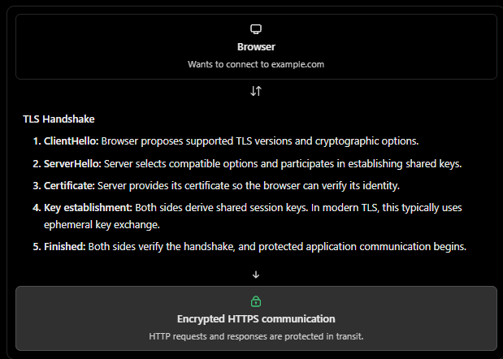

### SSL/TLS

> TLS encrypts data in transit, verifies the server's identity, and protects data from being secretly modified while traveling over the network.

### 1. What are SSL and TLS?
Imagine you log in Trello like application:
```
Browser                         Server
   |                                |
   |  email + password              |
   |------------------------------->|
```

Without encryption, someone who can observe the network traffic might be able to read sensitive information.

TLS protects the communication:
```
Browser                         Server
   |                                |
   |  encrypted HTTPS traffic       |
   |<==============================>|
   |                                |
```

- SSL (secure sockets layer) : The older protocol, now deprecated and insecure.
- TLS(Transport Layer security) : It is modern successor.
- HTTPS: HTTP carried over TLS.

### 2. The three security guarantees of TLS
TLS provides three key protections:
1. Confidentiality: Encrypts traffic so a network observer cannot read its contents.
Example: your password is not visible as plaintext in captured HTTPS traffic.

2. Integrity: Detects unauthorized modification of protected data in transit.
Example: An attacker cannot silently change a protected payment request without detection.

3. Authentication: Allows the browser to verify the server's identity using its certificate.
Example: The browser checks that the certificate is trusted and valid for the requested domain.

### 3. How does the TLS handshake work?
Before sending normal HTTPS data, the browser and server establish a secure connection through a process called the TLS handshake.



Why do we need both public-key and symmetric cryptography?
- Public key cryptograph: Helps authenticate the server and establish shared secrets securely.
- Symmetric cryptography: User derived session keys to encrypt application traffic efficiently.


### 4. What is an SSL/TLS certificate?
A certificate is a digitally signed document that binds a domain name to a public key and identifies the certificate's subject.

for example:

```
Domain: app.example.com
Public key: ...
Issuer: Trusted Certificate Authority
Validity: Start date → Expiry date
Digital signature: ...
```

A certificate Authority(CA) is an entity trusted to issue or sign certificates.

The browser validates the certificate chain and checks that the corticate is valid for the requested domain and meets applicable trust requirement.

```
app.example.com certificate
           |
           v
Intermediate CA certificate
           |
           v
Trusted Root CA
           |
           v
Browser trusts the chain
```

If the certificate is expired, untrusted or issued for the wrong domain, the browser may display security warning or reject  the connection.

### 5. Where does TLS fit in a system design?

Consider a production application deployed behind a load balancer.
```
Browser
   |
   | HTTPS / TLS
   v
Load Balancer
   |
   | HTTPS / TLS (if configured)
   v
Express.js API
   |
   | TLS (if configured)
   v
PostgreSQL
```

**TLS termination: ** The load balancer decrypts incoming HTTPS traffic and forwards requests to the backend. if the internal hop uses HTTP, that hop is not encrypted by TLS.

**End to end protection across hops:** You can use TLS from the load balancer to the application and from the application to the database as well.

> for sensitive internal services, mutual TLS (mTLS) can require both client and server to present certificate, providing mutual authentication.

