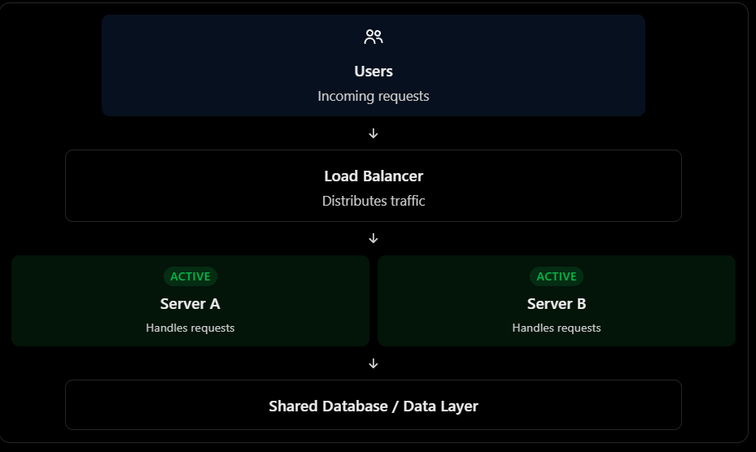
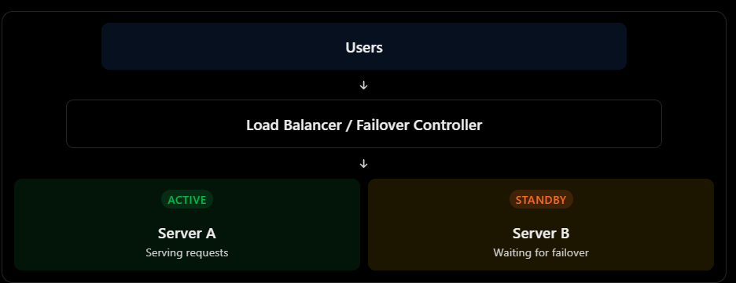

### Availability  

#### 1. What is availability?
Availability means how much times a system remains operational and accessible to users when they need it.

$$
\text{Availability} = \left( \frac{\text{Uptime}}{\text{Uptime} + \text{Downtime}} \right) \times 100
$$

#### 2. What are Availability Nines?
| Availability | Downtime per Year (Approx.) |
|-------------|-----------------------------|
| 90%         | 36.5 days                   |
| 99%         | 3.65 days                   |
| 99.9%       | 8 hours 46 minutes          |
| 99.99%      | 52.6 minutes                |
| 99.999%     | 5.26 minutes                |

#### 3. How do we achieve high availability?

Important technique
| Technique           | Purpose                                      |
|---------------------|----------------------------------------------|
| Redundancy          | Maintain multiple instances of critical components |
| Load Balancing      | Distribute traffic across servers            |
| Health Checks       | Detect unhealthy instances                   |
| Failover            | Switch to a healthy backup                   |
| Replication         | Maintain multiple copies of data             |
| Multi-AZ Deployment | Survive availability-zone failures           |
| Auto-Scaling        | Add instances when demand increases          |

#### 4. Understand Single Point of Failure(SPOF)

A single point of failure is a component whose failure can bring down the entire system.

for example:

Better architecture:

#### 5. Active-Active architecture:
In active-active architecture, multiple instances of a system are running simultaneously and actively serving user request.

**Advantages**
1. Better resource utilization.
2. High availability
3. No need to activate a standby application server during a single instance failure.

**Disadvantages**
1. More complex deployment and configuration.
2. Shared dependencies like databases can still become SPOFs.

#### 6. Active-passive architecture:
In active-passive architecture, one instance actively handles requests while another instance remains on standby, ready to take over if the active instance fails.

**Advantages**
1. Standby instances is ready for recovery.
2. Can simplify certain stateful architectures.
3. Cost will decrease as compare to active-active architecture.

**Disadvantage**
1. standby resources may remain underutilized.
2. failover can cause temporary downtime.
3. failover mechanism need careful testing.
