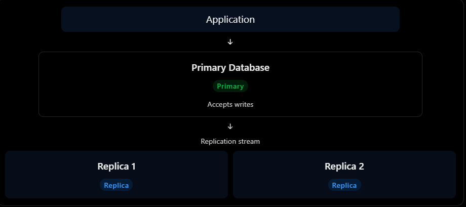
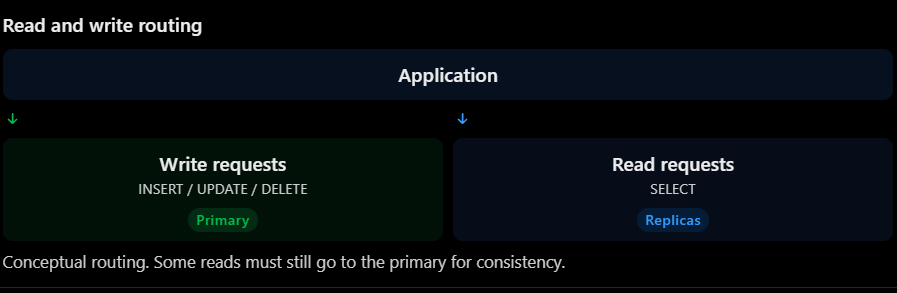
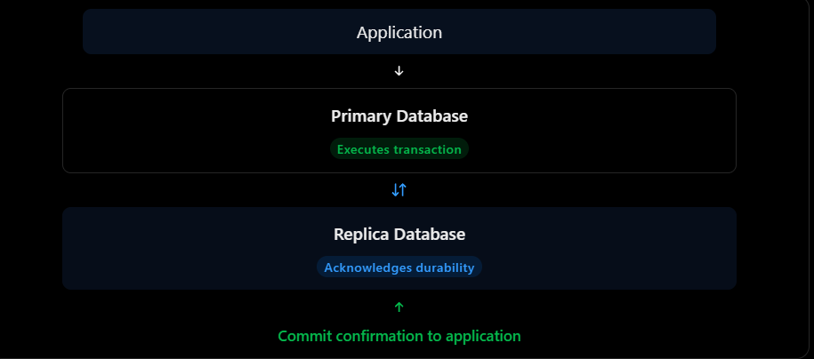
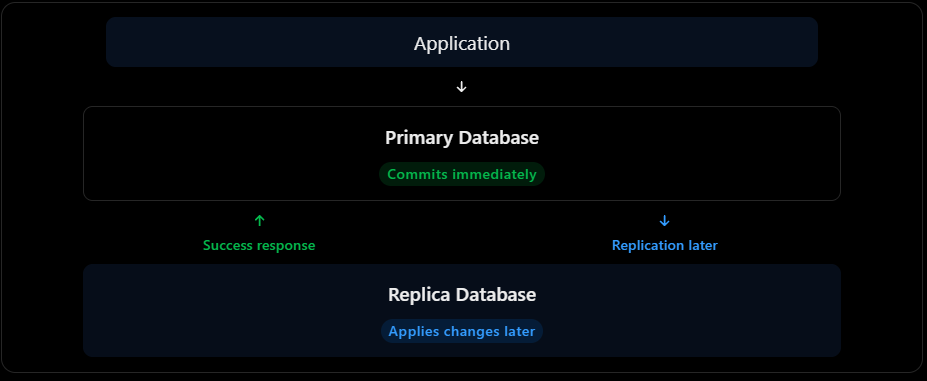
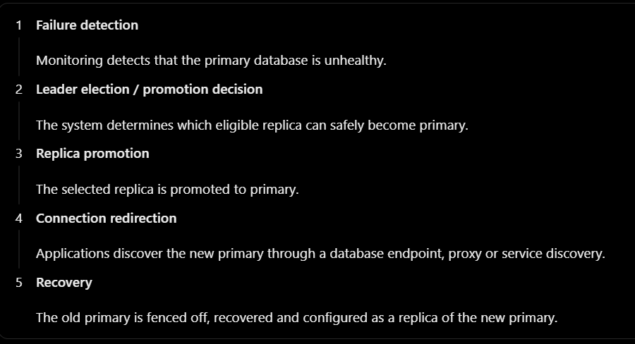

### Availability  

#### 1. What is availability?
Availability means how much times a system remains operational and accessible to users when they need it.

$$
\text{Availability} = \left( \frac{\text{Uptime}}{\text{Uptime} + \text{Downtime}} \right) \times 100
$$

#### 2. What are Availability Nines?
| Availability | Downtime per Year (Approx.) |
|-------------|-----------------------------|
| 90%         | 36.5 days                   |
| 99%         | 3.65 days                   |
| 99.9%       | 8 hours 46 minutes          |
| 99.99%      | 52.6 minutes                |
| 99.999%     | 5.26 minutes                |

#### 3. How do we achieve high availability?

Important technique
| Technique           | Purpose                                      |
|---------------------|----------------------------------------------|
| Redundancy          | Maintain multiple instances of critical components |
| Load Balancing      | Distribute traffic across servers            |
| Health Checks       | Detect unhealthy instances                   |
| Failover            | Switch to a healthy backup                   |
| Replication         | Maintain multiple copies of data             |
| Multi-AZ Deployment | Survive availability-zone failures           |
| Auto-Scaling        | Add instances when demand increases          |

#### 4. Understand Single Point of Failure(SPOF)

A single point of failure is a component whose failure can bring down the entire system.

for example:


Better architecture:


#### 5. Active-Active architecture:
In active-active architecture, multiple instances of a system are running simultaneously and actively serving user request.


**Advantages**
1. Better resource utilization.
2. High availability
3. No need to activate a standby application server during a single instance failure.

**Disadvantages**
1. More complex deployment and configuration.
2. Shared dependencies like databases can still become SPOFs.

#### 6. Active-passive architecture:
In active-passive architecture, one instance actively handles requests while another instance remains on standby, ready to take over if the active instance fails.


**Advantages**
1. Standby instances is ready for recovery.
2. Can simplify certain stateful architectures.
3. Cost will decrease as compare to active-active architecture.

**Disadvantage**
1. standby resources may remain underutilized.
2. failover can cause temporary downtime.
3. failover mechanism need careful testing.

#### 7. Database Replication and failover

##### 1. What is database replication?
Database replication means maintaining copies of database data across multiple database servers.

Let suppose if our application have single db

Problem: If this database crashes, our application become unavailable.

We can solve this using replication


Now we have three database instances.
- Primary: Handles writes.
- Replica 1: Maintains a copy of the data.
- Replica 2: Maintains another copy of the data.

##### 2. Primary-Replica Architecture
This architecture is also known as:
- Leader-Follower
- Master-Slave (older terminology)
- Primary-Secondary

Let's understand the workflow.
Write operation
Suppose a user creates an order.

```sql
INSERT INTO orders (user_id, amount)
VALUES (101, 2500);
```

The flow:
1. Application sends the write request to the primary.
2. Primary executes the SQL query.
3. Primary records the change in its transaction log.
4. The change is replicated to the replicas.
5. Replicas apply the change to their local databases.

Read operation
Suppose a user wants to view their order history.

```sql
SELECT * FROM orders WHERE user_id = 101;
```

The application can send this request to a replica.

This distributes read traffic.


Why is this useful?
Imagine:
- 10,000 read requests per second.
- 1,000 write requests per second.
Instead of sending everything to one database, we can distribute reads across replicas while keeping writes on the primary.

This is called Read Scaling.

#### 3. Synchronous vs Asynchronous Replication
A. Synchronous Replication
In synchronous replication, the primary waits for the required replica acknowledgement before confirming the transaction as committed to the client.

Consider this example:

You transfer ₹5,000 from Account A to Account B.

The flow:
1. Application sends the transaction to the primary database.
2. Primary executes the transaction.
3. Primary sends the change to the replica.
4. Replica acknowledges that it has durably received the change.
5. Primary confirms the commit to the application.



**Advantages:**
- Stronger durability guarantees.
- Reduced risk of losing acknowledged transactions during primary failure, assuming the required replica survives and promotion rules are followed.

**Disadvantages:**
- Higher write latency.
- Network problems can delay or block commits.
- If a required replica becomes unavailable, writes may stop depending on the replication configuration.

B. Asynchronous Replication
In asynchronous replication, the primary does not wait for the replica to acknowledge the change before confirming the commit to the application.

Flow:
1. Application sends a write request.
2. Primary commits the transaction.
3. Primary confirms success to the application.
4. Primary sends the changes to replicas.
5. Replicas apply the changes later.



**Advantages:**
- Lower write latency.
- Primary can continue accepting writes without waiting for replica acknowledgements.
- Useful for geographically distributed replicas.
**Disadvantages:**
- Replication lag can occur.
- If the primary crashes before changes reach a surviving replica, acknowledged transactions may be lost during failover.

#### 4. What is Replication Lag?
Replication lag means the time difference between a change being committed on the primary and becoming available on a replica.

How do we solve replication lag issues?
There are several approaches:
1. Read-your-writes consistency: After a user updates data, route their subsequent reads to the primary for some period or until the replica catches up.
2. LSN-based tracking: Track the primary's log sequence number and wait until a replica has replayed the required position.
3. Synchronous replication: Use appropriate synchronous acknowledgement guarantees.
4. Read routing: Send consistency-sensitive queries to the primary and less sensitive queries to replicas.

#### 5. What is Database Failover?
Now let's assume your primary database crashes.

You have:
- Primary DB
- Replica 1
- Replica 2
How does your system recover?

This process is called database failover.
Failover workflow

