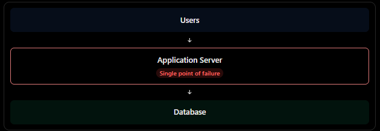
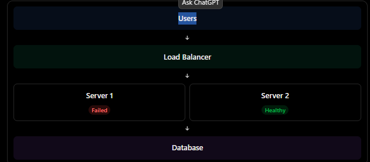

### 1. What is reliability?
Reliability is the ability of a system to perform its intended function correctly and consistently over a period of tim, even when failures occur.

A reliable system should:
1. Work correctly
2. Be available when users need it.
3. Protect user data.
4. REcover from failures.
5. Handle unexpected problems gracefully.

### 2. Four important concept of reliability
| Concept | Meaning |
|---|---|
| **Fault Tolerance** | System continues working despite component failures. |
| **Redundancy** | Having backup components to avoid a single point of failure. |
| **Failover** | Switching to a healthy backup when the primary fails. |
| **Disaster Recovery** | Restoring systems and data after a major failure. |

### 3. Important  reliability metrics
- MTBF(mean time between failures): Average operating time between failures.
- MTTR(mean time to repair): Average time required to restore service after failure.

### 4. Fault tolerance
Fault tolerance means designing a system so that it continues providing its essential functionality even when one or more components fail.

### 5. Redundancy
Redundancy means keeping additional instances of important components so that the system does not depend on just one.

Now:
1. Server 1 crashes.
2. Load balancer detects its failure.
3. Requests are routed to server 2.
4. Users can continue using the application.
