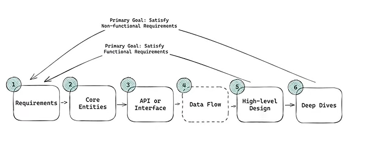
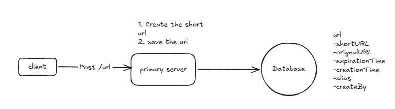
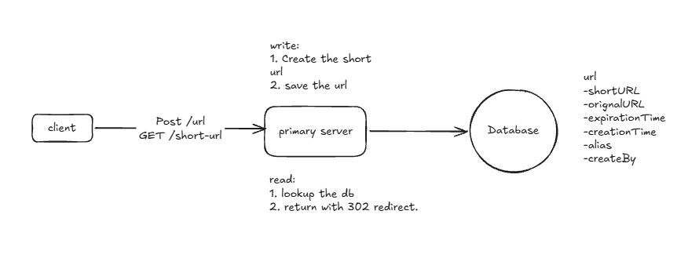
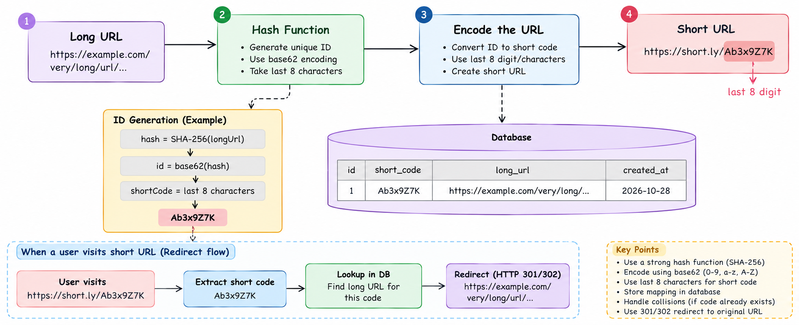

# URL Shortener like Bit.ly (SDE 2 Level)

Bit.ly is a URL shortening service that converts long URLs into short, manageable links.
`https://example.com/very/long/path?with=params` → `https://short.ly/aB3x9Z7`

This is one of the **most asked** HLD questions. At SDE 2 level, the interviewer is not checking if you know "use a hash + DB". They check:
- Can you **drive the interview** with a structure (requirements → estimates → API → HLD → deep dives)?
- Can you **do the numbers** and let them drive decisions?
- Can you **compare 2-3 approaches with trade-offs** and pick one with a reason?
- Do you think about **failure cases, edge cases, and scale bottlenecks** without being asked?



### Time plan for a 45-60 min round
| Step | Time |
|---|---|
| Requirements (functional + non-functional) | 5 min |
| Capacity estimation | 3-5 min |
| Core entities + API | 5 min |
| High level design (make it work) | 10 min |
| Deep dives (make it scale, fast, reliable) | 20-25 min |
| Wrap up: bottlenecks, monitoring, what you'd do next | 3-5 min |

---

## 1. Requirements

### Functional Requirements
1. Users can create a short URL from a long URL.
    - Optionally support a **custom alias** (`short.ly/my-resume`).
    - Optionally support an **expiration time**.
2. Users can open the short URL and get **redirected** to the original URL.

### Out of scope (say it out loud, then move on)
- User authentication and account management.
- Analytics on link clicks (click counts, geo data). *Be ready for it as a follow-up, see section 8.*
- Editing the destination of an existing short URL.

### Non-Functional Requirements
1. **Low latency on redirects**: p99 < 100ms.
2. **Scale**: 100M DAU, 1B stored URLs.
3. **Uniqueness**: one short code maps to exactly one long URL. Never break this.
4. **High availability** for redirects (99.99%). A broken short link means a broken link on someone's website, email, or QR code.
5. **Eventual consistency is OK** for creation. If a new link takes a few hundred ms to show up in every region, that's fine.
6. **Very read heavy**: reads >> writes (around 100:1 to 1000:1).
7. **Durability**: once created, a link must never be lost.

> SDE 2 tip: say *why* each requirement matters. For example: "Because reads are 1000x writes, I'll optimize the read path with caching and keep the write path simple."

---

## 2. Capacity Estimation (Back of the Envelope)

Keep the numbers rough and round. The goal is to make decisions, not to be exact.

**Traffic**
- 100M DAU, each doing ~1 redirect/day → 100M redirects/day
- 100M / ~100k seconds per day ≈ **1,000 reads/sec average**
- Peak ≈ 10x → **~10k reads/sec** (a viral link can spike even higher)
- Writes: ~1M new URLs/day → **~10-12 writes/sec**, peak ~100/sec
- 1B URLs ÷ 1M/day ≈ ~3 years of data

**Storage**
- One row ≈ 500 bytes (short code, long URL, created_at, expires_at, user_id, metadata)
- 1B × 500 B = **500 GB**. With 3 replicas ≈ 1.5 TB. Small for modern systems.

**Cache**
- 80/20 rule: 20% of links get 80% of traffic.
- Caching the ~10M hottest links × 500 B ≈ **5 GB**. Fits easily in one Redis node (we still use a cluster for HA).

**Bandwidth**
- A redirect response is ~500 B → 10k × 500 B = 5 MB/s. Not a concern.

**Short code length**

| Length | Base62 combinations |
|---|---|
| 6 | 62^6 ≈ 56.8 Billion |
| 7 | 62^7 ≈ 3.5 Trillion |
| 8 | 62^8 ≈ 218 Trillion |

For 1B URLs, **7 characters** gives ~3,500x headroom. 6 is also enough with a counter, but 7 is safer with random/hash codes because it keeps collisions rare.

**What the numbers tell us:**
- Writes are tiny → any database can handle them. A single Postgres primary is fine.
- Reads are ~1000x writes → **caching is the main design lever**.
- 500 GB → sharding is *not needed on day one*, but we should know how we would do it.

---

## 3. Core Entities
- **URL mapping**: short_code, original_url, created_at, expires_at, user_id (optional)
- **User** (optional, only for ownership / rate limiting)

### Data model
```sql
CREATE TABLE urls (
  short_code   VARCHAR(16) PRIMARY KEY,   -- PK = unique + indexed automatically
  original_url TEXT        NOT NULL,
  is_custom    BOOLEAN     DEFAULT FALSE,
  created_at   TIMESTAMP   NOT NULL,
  expires_at   TIMESTAMP   NULL,
  user_id      BIGINT      NULL
);
```
- Our main access pattern is `get by short_code`. Making it the **primary key** means a unique constraint plus an index for free.
- The PK unique constraint is the **final safety net** against duplicate codes, no matter which generation approach we use.

---

## 4. API Design

### Create short URL
```
POST /api/v1/urls
```
```json
{
  "original_url": "https://example.com/very/long/url",
  "custom_alias": "my-resume",          // optional
  "expires_at": "2026-12-31T00:00:00Z"   // optional
}
```
Response `201 Created`
```json
{
  "short_url": "https://short.ly/aB3x9Z7",
  "expires_at": "2026-12-31T00:00:00Z"
}
```
Errors:
- `400 Bad Request`: invalid URL, bad alias format, expiry in the past
- `409 Conflict`: custom alias is already taken
- `429 Too Many Requests`: rate limited

### Redirect
```
GET /{short_code}
```
- `302 Found` + `Location: <original_url>`
- `404 Not Found`: code does not exist
- `410 Gone`: code existed but has expired (optional, more precise than 404)

> Use a POST for create, not GET. Creating something is not idempotent and long URLs can break query string limits.

---

## 5. High Level Design

### 5.1 Create a short URL


1. Client sends `POST /urls` to the **Write Service** (behind a load balancer / API gateway).
2. The service validates the URL: scheme is `http/https` only (block `javascript:`), max length (~2048), and it must not point back to our own domain (that would create a redirect loop).
3. If there is a custom alias → validate it and try to insert it.
   Else → generate a unique short code (see deep dive 6.1).
4. Insert into the DB. If the unique constraint fails → return 409 (custom alias) or retry with a new code (generated).
5. Return the short URL.

### 5.2 Redirect


1. Client hits `GET short.ly/aB3x9Z7`.
2. **Read Service** checks the cache (Redis) → on a miss, checks the DB → fills the cache.
3. If the link has expired → 410/404.
4. Return a `302` with the `Location` header.

### 301 vs 302 (a very common question)

| | 301 Moved Permanently | 302 Found (Temporary) |
|---|---|---|
| Browser caches it? | Yes, next visit skips our server | No, every visit hits us |
| Server load | Lower | Higher |
| Can we expire / delete / change the link? | **No**, browsers keep the cached copy | Yes |
| Click analytics possible? | No (we miss repeat clicks) | Yes |

**Pick 302** (or 307), because we support expiration and may want analytics later. Choosing 301 would mean we lose control of a link once a browser has cached it. The extra load is handled by our cache and CDN.

Response examples:
```
HTTP/1.1 302 Found
Location: https://www.original-long-url.com
Cache-Control: private, max-age=0
```

---

## 6. Deep Dives

### 6.1 How do we generate unique, short codes? (Most important deep dive)

Goals:
1. Unique (never two long URLs on one code)
2. As short as possible
3. Fast to generate, and works with many Write Service instances
4. (Nice to have) Not easy to guess, so people can't scan all links

#### ❌ Bad: Long URL prefix
Take the first N characters of the URL (`www.link`). Every URL that starts with `www.linkedin.com/...` would get the same code. This breaks uniqueness. Mention it only to show why we need entropy or a counter.

#### ✅ Approach A: Hash (or random) + Base62 + collision check
```
hash      = SHA-256(long_url [+ salt])
code      = base62(hash)[0:7]
if code exists in DB → rehash with salt/counter appended and try again
```
- **Why base62?** `a-z A-Z 0-9` are all URL safe. Base64 adds `+` and `/`. `/` is a path separator and `+` can be read as a space in query strings.
- **Deterministic**: the same URL always gives the same code → free **deduplication**. If you don't want that (e.g. each user gets their own link), add a salt / user_id / nonce.
- **Random codes** (a CSPRNG giving 7 base62 chars) behave the same way for collisions, just without determinism.



**Collision math**: with |S| possible codes and n already used, the next code collides with probability **n / |S|**.
- 1B used, 7 chars (3.5T) → ~0.03% per insert. Rare, but it *will* happen at our scale.
- So every insert needs a **check + retry**. Do not check then insert, because two requests can race. Instead **insert and let the unique constraint reject duplicates** (`INSERT ... ON CONFLICT DO NOTHING`, or a DynamoDB conditional put), then retry.

| Pros | Cons |
|---|---|
| No coordination between servers | Collisions grow as data grows → retries |
| Codes are not guessable | Every write needs a DB uniqueness check |
| Free dedup (if deterministic) | Truncating a hash throws away most of its entropy |

#### ✅ Approach B: Global counter + Base62 (no collisions)
```
id   = counter.incr()     // 1, 2, 3, ... 1,000,000,000
code = base62(id)         // 1B → "15FTGg" (6 chars)
```
```python
ALPHABET = "0123456789abcdefghijklmnopqrstuvwxyzABCDEFGHIJKLMNOPQRSTUVWXYZ"
def base62(n):
    s = []
    while n > 0:
        n, r = divmod(n, 62)
        s.append(ALPHABET[r])
    return "".join(reversed(s)) or "0"
```
- Every id is unique → every code is unique → **no collision check needed**.
- Codes are as short as possible (grow from 1 char up to 6).

**Problem 1: where does the counter live with many Write Service instances?**
- Use a **central Redis** with `INCR`. It is atomic and single threaded, and handles 100k+ ops/sec.
- **Counter batching**: each instance does `INCRBY counter 1000` and gets a range like 5001-6000, then hands those out from memory. Redis load drops 1000x.
- If an instance crashes, its unused range is lost. That's fine, because we need *uniqueness*, not *continuity*.

**Problem 2: Redis failover can re-issue ids ⚠️**
- If the Redis primary dies before replicating its latest value, the replica's counter is **behind**. It will hand out ids that were **already used** → duplicates.
- Fixes: turn on AOF persistence, **bump the counter by a big safety gap** (e.g. +1M) after failover, and keep the DB unique constraint as the final guard (on conflict → take the next id).
- Alternatives to Redis: a DB sequence, **ZooKeeper/etcd giving out ranges**, or Snowflake-style ids (timestamp + machine id + sequence, no central counter, but longer codes, ~11 chars).

**Problem 3: sequential codes are predictable**
- `aB3x9Z7`, `aB3x9Z8`... anyone can scan every link, which leaks private links (Google Docs, invoices).
- Fix: **scramble the id with a reversible (bijective) function** before encoding. For example, multiply by a large prime mod 62^7, use a small Feistel cipher, or a library like Sqids/Hashids. It stays unique (1-to-1) but no longer looks sequential.

**Multi-region**: give each region its own range (region A: 0-1T, region B: 1T-2T) so regions never need to coordinate on writes.

#### ✅ Approach C: Key Generation Service (KGS), pre-generated keys
- An offline job pre-generates random unique 7-char codes and stores them in a `unused_keys` table.
- Each Write Service asks KGS for a batch (e.g. 1000 keys) and keeps them in memory. KGS marks them used (moves them to `used_keys`) **in one transaction**, so two servers never get the same key.
- Pros: no collision check at write time, codes not guessable, very fast.
- Cons: one more service to run (KGS must be replicated or it is a SPOF), keys held by a crashed server are lost (acceptable), and you need storage for the pre-generated keys (3.5T × 7 B is large, so only generate a few billion ahead).

#### Comparison (have this table ready)

| | Hash/Random | Counter + Base62 | KGS |
|---|---|---|---|
| Collisions | Possible → retry | None | None |
| Coordination | None | Central counter | KGS service |
| Guessable | No | Yes (unless scrambled) | No |
| Code length | Fixed 7-8 | Grows, 6 at 1B | Fixed 7 |
| Complexity | Low | Medium | High |

**What I'd say in the interview:** "I'll go with **counter + base62 with counter batching in Redis**, and scramble the id so codes aren't sequential. It gives zero collisions and the shortest codes. The DB unique constraint stays as a safety net." Hash + retry is also a perfectly fine answer if you explain the collision handling.

---

### 6.2 Custom alias: edge cases interviewers love
- **Validation**: 3-30 chars, `[a-zA-Z0-9_-]`, case sensitivity decided (usually case sensitive), **reserved words** blocked (`api`, `admin`, `login`, `health`).
- **Race condition**: two users ask for `my-resume` at the same moment → don't do `SELECT` then `INSERT`. **Just INSERT** and let the unique constraint pick the winner → the loser gets **409**.
- **Clash with generated codes**: the counter might later produce a code equal to a custom alias someone already took. Options:
    - Make custom aliases use a different shape (e.g. min length 8, or must contain `-`), or
    - On insert conflict, the generator just takes the next id.
- Custom aliases live in the **same table / namespace** as generated codes, so a redirect is always one lookup.

### 6.3 Expiration: how to handle it
- Store `expires_at` in the row.
- **Check on read (lazy)**: if `now > expires_at` → return 410/404. This is the source of truth.
- **Cache TTL** = `min(default_ttl, expires_at - now)` so the cache never serves an expired link.
- **Cleanup (eager)**: a background job deletes expired rows in batches during off-peak hours, or use the DB's built-in TTL (DynamoDB TTL, Cassandra TTL).
- **Can we reuse expired codes?** Usually **no**: old links may still be printed on QR codes or posters, and reusing them could send users to the wrong site. Codes are cheap, so don't reuse.

### 6.4 How do we make redirects fast (<100ms)?

**Layer 1: DB index.** `short_code` is the primary key → O(log n) B-tree lookup, no full scan.

**Layer 2: Distributed cache (Redis), cache-aside pattern**
```
code → Redis GET
   hit  → return 302
   miss → DB read → Redis SET code url EX ttl → return 302
```
- **Eviction: LRU**, because popular links stay hot.
- **Expected hit ratio**: 90%+ (80/20 traffic). Redis GET ~1ms vs DB ~5-10ms.
- **Write-through on create?** Optional. New links are often clicked right after creation (shared in chat), so warming the cache on create helps.

**Cache problems you should bring up yourself (this is what makes it SDE 2):**

| Problem | What happens | Fix |
|---|---|---|
| **Cache penetration** | Bots hit random codes that don't exist → every request misses → DB hammered | **Negative caching** (cache "NOT_FOUND" for ~1-5 min) and/or a **Bloom filter** of all valid codes in front of the DB |
| **Cache stampede (thundering herd)** | A viral link's cache entry expires → 10k requests miss at once → all hit the DB | **Request coalescing / single-flight** (only one request loads from the DB, the others wait), or a lock, or add random jitter to TTLs |
| **Hot key** | One viral link → one Redis shard is overloaded | **Local in-process LRU cache** (a few seconds TTL) in each Read Service + CDN; replicate hot keys |
| **Cache down** | All traffic falls to the DB | Redis Cluster with replicas, a circuit breaker, DB read replicas sized to survive a cache outage |
| **Stale cache** | Link deleted / expired but still cached | Delete the cache key on delete, TTL bounded by `expires_at` |

**Layer 3: CDN / Edge**
- Serve `short.ly` through a CDN (Cloudflare, CloudFront). Popular codes get answered at the PoP near the user without reaching our servers.
- Redirect logic can run at the edge (Cloudflare Workers, Lambda@Edge) with the code → URL mapping in an edge KV store.
- **Trade-offs**: cache invalidation across hundreds of PoPs is hard and slow (purge APIs), it costs more, edge functions have limits (CPU time, memory, libraries), it is harder to debug, and **we lose click visibility** unless the edge logs clicks.
- You're trading cost and complexity for latency. Worth it for global, very high traffic. Mention it as a "next step", not the day-one design.

**Layer 4: Multi-region**
- Deploy Read Services + cache + DB read replicas in several regions. Use GeoDNS / Anycast to route users to the nearest one.
- Writes can go to one primary region (writes are only ~10/s), and replication to other regions is async. A new link may take ~100s of ms to show up worldwide, which is fine because we chose eventual consistency.
- Edge case: a user creates a link in region A and the friend clicks it in region B before replication → miss in B. Fix: on a miss in a replica region, **fall back to the primary region** before returning 404.

---

### 6.5 How do we scale to 1B URLs and 100M DAU?

**Split the services (read and write)**
- Read Service (redirects, ~10k RPS) and Write Service (create, ~100 RPS) have very different load. Split them so each **scales horizontally on its own**.
- Both are **stateless** → put them behind a load balancer and add instances with auto scaling.

**Database choice**
- Any DB works. Writes are ~10/s and the cache absorbs most reads.
- **Postgres/MySQL**: strong consistency, unique constraint, easy. Good default. *"I'd pick Postgres because I know it well and the data fits on one node."*
- **DynamoDB/Cassandra**: a pure key-value access pattern (get by short_code), built-in horizontal scale + TTL, multi-region tables. Good if we expect 10B+ URLs.
- Say which you pick and **why**. There's no single right answer, only a reasoned one.

**Sharding (when we outgrow one node)**
- Shard key = **short_code** (hash based), because every redirect is a lookup by short_code → always hits **one shard**.
- Use **consistent hashing** so adding a shard only moves ~1/N of the keys.
- Trade-off: "find the existing short code for this long URL" (dedup) now needs a **secondary index on long_url** or a separate `long_url_hash → short_code` table, also sharded.
- Don't shard by user_id or created_at: redirects don't know the user, and created_at puts all new writes on one hot shard.

**High availability for the DB**
- **Replication**: 1 primary + 2 or more replicas (across AZs). Reads can go to replicas. On primary failure, **automatic failover** promotes a replica (Patroni, RDS Multi-AZ). Async replication means a tiny window of possible data loss, while sync replication means no loss but slower writes.
- **Backups** are for **disaster recovery**, not HA: daily snapshots + continuous WAL/point-in-time recovery, stored in another region. Know the terms **RPO** (how much data you can lose) and **RTO** (how fast you recover).

**Final architecture**
```
                     ┌──────────────┐
Client ── DNS ──────▶│  CDN / Edge  │──(hit)──▶ 302
                     └──────┬───────┘
                            │ miss
                     ┌──────▼───────┐
                     │ Load Balancer│  (+ rate limiter at API gateway)
                     └──┬────────┬──┘
           GET /{code}  │        │  POST /urls
                ┌───────▼──┐  ┌──▼────────────┐
                │  Read    │  │  Write        │──▶ Redis counter (INCRBY 1000)
                │  Service │  │  Service      │
                │ (local   │  └──┬────────────┘
                │  LRU)    │     │ insert
                └──┬───────┘     │
                   │ cache-aside │
            ┌──────▼──────┐      │
            │ Redis Cache │      │
            │  (cluster)  │      │
            └──────┬──────┘      │
                   │ miss        │
            ┌──────▼─────────────▼───────┐
            │  DB primary ──▶ replicas   │  (shard by short_code later)
            └────────────────────────────┘
                   │ async click events (optional)
                   ▼
                 Kafka ──▶ Analytics consumers ──▶ OLAP (ClickHouse)
```

---

## 7. Reliability, Security, and Operations

**Rate limiting / abuse**
- Rate limit `POST /urls` per IP / API key (token bucket at the API gateway). Otherwise a bot could burn through our code space or fill the DB.
- Rate limit redirects per IP lightly to stop scanning.
- Malicious URL check (Google Safe Browsing) **asynchronously** after creation. If a link is flagged → disable it and invalidate the cache.

**Failure scenarios (walk through 2-3 of these)**

| Failure | Impact | Mitigation |
|---|---|---|
| Redis cache down | All reads hit the DB | Cluster replicas, local LRU, DB replicas sized for it |
| Redis counter down | Writes fail | Instances still have batched ranges; Sentinel failover + safety gap bump |
| DB primary down | Writes fail, reads OK from cache/replicas | Auto failover in ~30s |
| Whole region down | Users in that region | GeoDNS fails over to another region |
| Write Service instance crash | Its unused counter range is lost | Fine, we only need uniqueness |

**Monitoring**
- Redirect **p50/p99 latency**, **cache hit ratio**, 4xx/5xx rates (a 404 spike = scanning bots), DB replication lag, counter usage vs code space, create QPS.

---

## 8. Common Follow-up Questions (with short answers)

1. **Why not just use the DB auto-increment id?**
   It works on one DB, but it ties id generation to one primary node. Once you shard or go multi-region, the ids are no longer globally unique without extra coordination. Redis ranges or KGS separate id generation from storage.

2. **Same long URL submitted twice, same or different short code?**
   It depends on the product. For anonymous users, deduplicate (hash approach, or a `long_url_hash` index) to save space. For logged-in users, give each user their own code, since they want their own link and analytics.

3. **How would you add click analytics without slowing redirects?**
   The Read Service sends the 302 first, then **asynchronously** publishes a click event (code, timestamp, IP→geo, user-agent, referrer) to **Kafka**. Consumers aggregate it into an OLAP store (ClickHouse/Druid) or counters. Never write to the DB synchronously on the redirect path. Note that 302 is required, and CDN-served redirects need edge logs.

4. **How do you handle a link that suddenly goes viral (1M RPS on one key)?**
   CDN caching, a local in-process cache in each Read Service, request coalescing on misses, and replicating the hot key across Redis replicas.

5. **What if someone tries to scan all codes?**
   Non-sequential codes (scrambled counter / random), 7+ chars, rate limiting by IP, negative caching + Bloom filter so scans don't hit the DB, and alerts on 404 spikes.

6. **How long until we run out of codes?**
   7 chars = 3.5T codes, at 1M/day ≈ 9,500 years. If needed, go to 8 chars. Old codes keep working.

7. **How do you delete / disable a link?**
   Soft delete in the DB (`is_active=false`), **delete the cache key**, and purge the CDN. This only works because we used 302. With 301, browsers may never ask us again.

8. **Strong or eventual consistency? Where does it matter?**
   Strong for **uniqueness at write time** (unique constraint / atomic counter). Eventual is OK for **propagation** of the new mapping to caches and other regions.

9. **SQL or NoSQL?**
   Both work, so give a reason. SQL: simple, unique constraints, the data fits on one node. NoSQL (DynamoDB): key-value access, auto scaling, built-in TTL, global tables.

10. **How would you support updating the destination URL?**
    Update the DB row → delete the cache key → purge the CDN. Again, only possible with 302.

11. **Redis counter vs Snowflake id?**
    Redis: short codes (6-7 chars) but needs a central component. Snowflake: no coordination, but 64-bit ids → ~11 char codes, too long for a "short" URL.

12. **How do you prevent redirect loops?**
    Reject original URLs whose host is our own short domain (and other known shorteners, optionally).

13. **What does your cache key / value look like?**
    Key `url:{short_code}` → value `{original_url, expires_at}`. TTL = min(24h, time to expiry).

14. **How would you test / roll this out?**
    Load test the read path at 10x peak, canary deploy, monitor cache hit ratio and p99 before ramping up.

---

## 9. Quick Revision Checklist
- [ ] Requirements + say what is out of scope
- [ ] Estimation: ~10k read RPS peak, ~100 write RPS, 500 GB, 7 chars base62
- [ ] API: POST /urls (201/400/409/429), GET /{code} (302/404/410)
- [ ] 302 over 301, with the reason
- [ ] Code generation: compare hash vs counter vs KGS → pick one, with collision / failover handling
- [ ] Unique constraint as the final guard; INSERT instead of check-then-insert
- [ ] Custom alias races + reserved words; expiry = lazy check + cleanup job
- [ ] Cache-aside + LRU, plus penetration / stampede / hot key fixes
- [ ] CDN + multi-region as the latency next step
- [ ] Read/write split, stateless horizontal scaling, shard by short_code, replication + backups (RPO/RTO)
- [ ] Analytics via Kafka async
- [ ] Rate limiting, failure scenarios, monitoring
