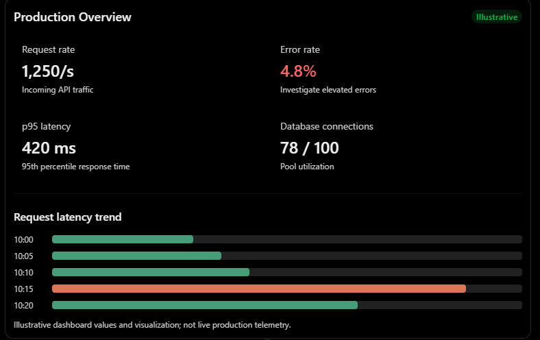
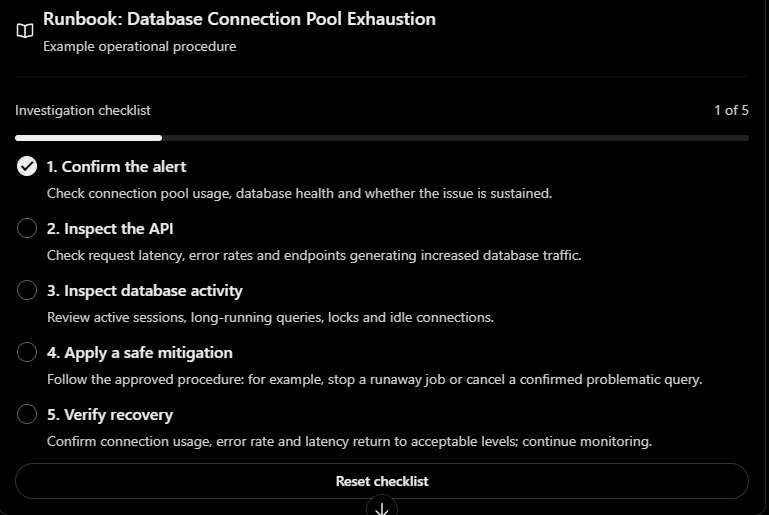
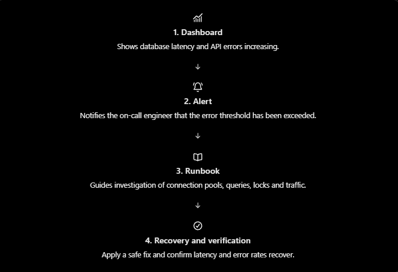

### Dashboards and Runbooks

- Dashboard: shows what is happening.
- Alert: Tells you something needs attention.
- Runbook: Tells you what to do about it.

### 1. What is dashboard?
A dashboard is a visual interface that displays important system metrics, trends, alerts and health information in one place.



### 2. What is runbooks?
A runbook is a documented, step-by-step procedure for investigating and responding to a known operational problem.

Suppose our monitoring systems raises this alert:

```
🚨 ALERT: PostgreSQL connection pool
   utilization > 90% for 5 minutes
```
A runbook provides the steps to trouble shoot the problem:



### 3. How dashboards , alerts and runbooks work together

