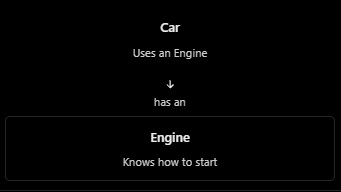
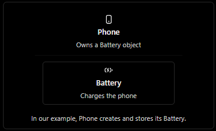
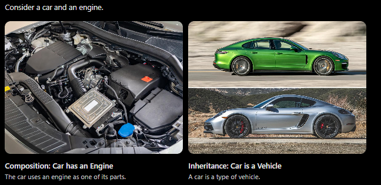
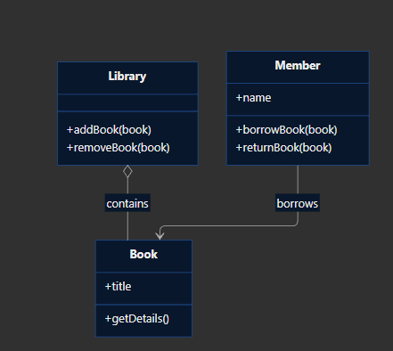

### Composition - building objects using other objects

Composition is an important concept in LLD. It helps us build larger systems from smaller, reusable parts.

### 1. Real world example
Think about a `car`. A car has an engine. Instead of writing all engine behavior directly inside the `Car` class, we can create a separate `Engine` and let `Car` use it.


Compare these two relationships:
- Inheritance: A `Car` is a `Vehicle`.
- Composition: A `Car` has an `Engine`.

### Typescript Implementation

```ts
class Engine {
  start() : void {
    console.log("Engine started");
  }
}

class Car {
  private engine: Engine;

  constructor() {
    this.engine = new Engine();
  }

  start(): void {
    this.engine.start();
    console.log("Car is ready to drive");
  }
}

const car = new Car();
car.start();
```

**Output**
```
Engine started
Car is ready to drive
```

What is happening?
1. The `Car` contains an `Engine` object.
2. When `car.start()` is called, the car asks its engine to start.
3. The car then prints that it is ready to drive.

The main idea: Instead of pulling every responsibility in one big class, we can split responsibilities into smaller classes that work together.

### Coding Exercise
Create two classes:
- Battery with a charge() method that prints "Battery is charging".
- Phone that contains a Battery object and has a chargePhone() method that calls battery.charge() and then prints "Phone is ready".
Finally, create a Phone object and call chargePhone().
```ts

class Battery {
  charge(): void {
    console.log("Battery is charging.");
  }
}

class Phone {
  private battery: Battery;

  constructor() {
    this.battery = new Battery();
  }

  chargePhone(): void {
    this.battery.charge();
    console.log("Phone is ready.");
  }
}

const phone = new Phone();
phone.chargePhone();

```


### 2. Object ownership in composition
Imagine we have bought phone. the phone has a battery installed inside it. When you create a `Phone`. it creates its own `Battery`.



In code we express this relationship using a constructor:

```ts
class Phone {
   private battery: Battery;

   constructor() {
    this.battery = new Battery();
   }
}
```

When we write `new Phone()`, the constructor creates the battery and stores it in that phone.

Why does this matter?
Because the `Phone` is responsible for ensuring it has a battery available when it needs to charge.

The battery's charing behavior remains indite the `Battery` class.

### Coding Exercise
Create a Laptop class that owns a Processor object.
- Processor has a method start() that prints "Processor started.".
- Laptop creates its own Processor inside its constructor.
- Laptop has a method boot() that calls processor.start() and then prints "Laptop booted.".
- Create two laptop objects and boot both.

```ts

class Processor {
  start(): void {
    console.log("Processor started.");
  }
}

class Laptop {
  private processor: Processor;

  constructor() {
    this.processor = new Processor();
  }

  boot(): void {
    this.processor.start();
    console.log("Laptop booted.");
  }
}

const laptop1 = new Laptop();
const laptop2 = new Laptop();

laptop1.boot();
laptop2.boot();

```

### Composition vs Inheritance

Let's learn one of the most important decisions in LLD: when should one class contain another object, and when should one class inherit from one another?

### 1. Real-world analogy



Use this simple rule:
- Has-a relationship → composition. A car has an engine.
- Is-a relationship → inheritance. A car is a vehicle.


### Composition vs Aggregation
We have learned that composition means one object contains another.

### 1. Real world example


This is a good example of aggregation: a whole has relationships with parts, but those parts can exist independently of that whole.

# Composition vs Aggregation

| Question                                | Composition                                                                 | Aggregation                                  |
|-----------------------------------------|------------------------------------------------------------------------------|----------------------------------------------|
| Does one object contain or organize another? | Yes                                                                          | Yes                                          |
| Can the part exist independently?       | Typically not within the modeled ownership relationship                      | Yes                                          |
| Example                                 | A house and its rooms, in a model where rooms belong exclusively to that house | A university and its students                |

### How would you model aggregation?
Suppose we have students created independently of a university.

```ts
class Student {
  constructor(public name: string) {}
}

class University {
  constructor(public students: Student[]) {}

  showStudents(): void {
    for (const student of this.students) {
      console.log(student.name);
    }
  }
}

const student1 = new Student("Asha");
const student2 = new Student("Rahul");

const university = new University([student1, student2]);
university.showStudents();
```
**Output**
```
Asha
Rahul
```

### Identify relationships in a class diagram

Read the diagram as follows:
- `Library o-- Book`: aggregation. A library keeps track of books, but books may exist independently of a particular library.
- `Member --> Book` : association. A member infracts with a book by borrowing and returning it.

### Put the relationships into typescript
```ts
class Book {
  constructor(public title : string) {}
}

class Library {
  private books: Book[] = [];
  
  addBook(book: Book): void {
    this.books.push(book);
  }

  showBooks(): void {
    for(const book of this.books) {
      console.log(book.title);
    }
  }
}

const book1 = new Book("Clean code");
const book2 = new Book("The Pragmatic Programmer")

const library = new Library()
library.addBook(book1);
library.addBook(book2);

library.showBooks();
```
