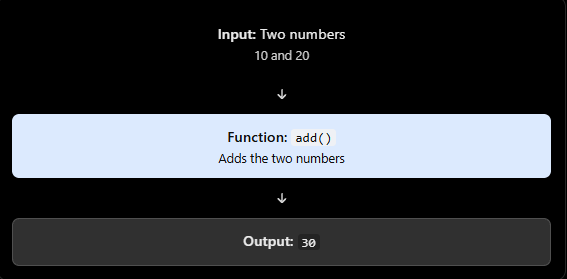

### Typescript Function
### 1. What is a function?
Think of a function as a machine:


### 2. Defining a function in TypeScript
```ts
function add(a:number , b: number) : number {
  return a + b;
}

const result = add(10,20)

console.log(result) // 30

```

### 3. What happens when the types ar wrong?

```ts
function multiply(a:number , b: number) : number {
  return a + b;
}

multiply(5, 4); // valid
multiply("5",5) // Typescript error
```
### 4. What if a function does not return anything

Sometimes a function performs an action instead of producing a result.

```ts
function printMessage(message: string): void {
  console.log(message);
}
```

`void` means you should not expect a useful return value from this function.


