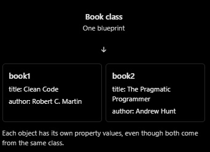

### Classes and Objects

> Class = Blueprint [Defines what an object should contain and do]
> Object = Actual house [A real instance created from that blueprint]

### 2. Create the first class
```ts
class Book {
  title: string,
  author: string

  constructor(title: string, author: string) {
    this.title = title;
    this.author = author
  }
}
```

Let's understand each part

`class Book` : Creates a blue print named `Book`.
`title: string` and `author: string`
There are properties. They store information about a book

`constructor(...)` : The constructor runs when we create a new object. It receives the initial information needed to create that object.

`this.title = title` : This assigns the input value to the current object's `title` property.

Think of `this`  as the particular object we are currently working with.

### 3. Create objects from the class

```ts
const book1 = new Book("Clean code", "Robert C. Martin");
const book2 = new Book("The pragmatic programmer", "Andrew Hunt")

console.log(book1.title)  // Clean Code
console.log(book2.title) // The pragmatic programmer
```
The `new` keyword creates a new object using the class blueprint.



### 4. Add behavior using methods
Objects can store information and perform actions.

Let's add a method to the `Book` class:

```ts
class Book {
  title: string
  author: string

  constructor(title: string, author: string) {
    this.title  = title;
    this.author = author
  }

  getDetails(): string {
    return `${this.title} by ${this.author}`;
  }
}
```
Here, `getDetails` is a method- a function that belongs to a class.

This is useful in LLD because we model real world entities with both information and behavior.

### Coding exercise 1
Create a BankAccount class with these requirements:
1. Add a owner property of type string.
2. Add a balance property of type number.
3. Create a constructor that accepts the owner's name and starting balance.
4. Add a method getBalance() that returns the balance as a number.
5. Create two different bank account objects and call getBalance() on both.

```ts
class BankAccount {
  owner: string
  balance: number

  constructor(owner: string, balance: number) {
    this.owner = owner;
    this.balance = balance;
  }

  getBalance(): number {
    return this.balance;
  }
}

const account1 = new BankAccount("Nilesh 1", 900000);
const account2 = new BankAccount("Nilesh 2", 1000000);
```

### Coding Exercise 2
your account can report its balance but cannot change it. Add a method called deposit().
Requirements:
1. Accept an amount of type number.
2. Add that amount to the current balance.
3. Return nothing, so use void.
4. Test it by depositing 500 into account1 and then printing its balance.

```ts

class BankAccount {
  owner: string;
  balance: number;

  constructor(owner: string, balance: number) {
    this.owner = owner;
    this.balance = balance;
  }

  getBalance(): number {
    return this.balance;
  }

  deposit(amount: number): void {
    this.balance += amount;
  }
}

const account1 = new BankAccount("Nilesh 1", 900000);

account1.deposit(500);

console.log(account1.getBalance()); // 900500

```

### Coding Exercise 3
task is to complete a BankAccount class with:
- A private balance property.
- A constructor that initializes the balance.
- A deposit(amount: number): void method that rejects zero or negative amounts.
- A getBalance(): number method.
- A test that deposits 500 into an account starting at 1000 and prints the result.

```ts

class BankAccount {
  private balance: number;

  constructor(balance: number) {
    this.balance = balance;
  }

  deposit(amount: number): void {
    if (amount <= 0) {
      throw new Error("Amount cannot be zero or less");
    }

    this.balance += amount;
  }

  getBalance(): number {
    return this.balance;
  }
}

const account1 = new BankAccount(1000);

account1.deposit(500);

console.log(account1.getBalance()); // 1500

```