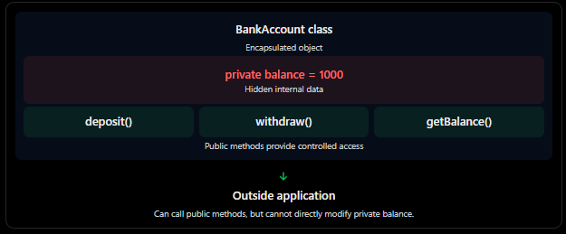

### 1. What is encapsulation?
Encapsulation means wrapping data(properties) and methods (functions) together inside a class and restricting direct access to the internal data.

eg: Think about an ATM machine.
- You cannot directly access the money stored inside the ATM.
- You cannot directly change your bank balance.
- You can withdraw money using the ATM interface.
- The ATM checks weather you have sufficient balance before allowing withdrawal.

This is encapsulation!
The ATM hides its internal data and exposes only controlled operations.

### 2. Without Encapsulation
```ts
class BankAccount {
 balance : number = 1000;
}

const account = new BankAccount();
account.balance = -5000;
console.log(account.balance)
```

What is wrong here?
Anyone can directly modify the balance.

### 3. With Encapsulation
Now let's protect the balance using the `private` access modifier.

```ts
class BankAccount {
  private balance: number=1000;
  getBalance(): number {
    return this.balance;
  }

  deposit(amount: number) : void {
    if(amount <= 0) {
      console.log("Invalid deposit amount")
      return;
    }
    this.balance+=amount;
  }

  withdraw(amount : number): void {
    if(amount <= 0) {
      console.log("Invalid withdraw amount")
      return;
    }

    if(amount > this.balance) {
      console.log("Insufficient balance")
      return;
    }

    this.balance -= amount;
  }
}

const account = new BankAccount()
account.deposit(500)
account.withdraw(200)
console.log(account.getBalance()) // 1300
```


### 4. Access Modifiers in TypeScript

Access modifiers define the visibility and accessibility of class properties and methods.

| Modifier | Accessible inside class | Accessible in child class | Accessible outside |
|----------|:-----------------------:|:--------------------------:|:------------------:|
| `public` | Yes | Yes | Yes |
| `private` | Yes | No | No |
| `protected` | Yes | Yes | No |

### 5. Coding exercise
Build a BankAccount class with the following requirements.

Task 1: Properties
- accountHolder – public string.
- accountNumber – private string.
- balance – private number.
Task 2: Constructor

Initialize all three properties using the constructor.

Task 3: Methods

Implement these methods:
1. deposit(amount: number) – Add money if amount is positive.
2. withdraw(amount: number) – Withdraw only if sufficient balance exists.
3. getBalance() – Return current balance.
4. getAccountNumber() – Return account number.

```ts
class BankAccount {
    public accountHolder: string;
    private accountNumber: string;
    private balance: number;

    constructor(
        accountHolder: string,
        accountNumber: string,
        balance: number
    ) {
        if (balance < 0) {
            throw new Error("Initial balance cannot be negative");
        }

        this.accountHolder = accountHolder;
        this.accountNumber = accountNumber;
        this.balance = balance;
    }

    deposit(amount: number): void {
        if (amount <= 0) {
            throw new Error("Deposit amount must be positive");
        }

        this.balance += amount;
    }

    withdraw(amount: number): void {
        if (amount <= 0) {
            throw new Error("Withdrawal amount must be positive");
        }

        if (amount > this.balance) {
            throw new Error("Insufficient balance");
        }

        this.balance -= amount;
    }

    getBalance(): number {
        return this.balance;
    }

    getAccountNumber(): string {
        return this.accountNumber;
    }
}
```