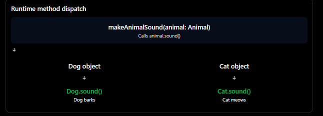

### 1. First Principle - Why was inheritance introduced?
#### 1.1 Imagine a real world problem
Suppose we are bailing an employee management system.
Our company has three types of employees:
- Developer
- Manager
- Designer

All employees have some common information:
- Name
- EmployeeId
- Email
- Department

But they also have different responsibilities.
For example:
| Employees | Responsibilities |
| --- | --- |
| Developer | Write code, review PRs |
| Manager | Manage team, conduct reviews |
| Designer | Create designs, maintain design systems |

Let's initially implement these as independent classes.
```ts
class Developer {
  name : string;
  employeeId : number ;
  email : string

  constructor(name : string, employeeId : number, email : string) {
    this.name = name;
    this.employeeId = employeeId;
    this.email = email;
  }

  login(): void {
    console.log(`${this.name} logged in`);
  }

  writeCode(): void {
    console.log(`${this.name} is writing code`);
  }
}
```

Now the manager class:
```ts
class Manager {
  name : string;
  employeeId : number;
  email : string;

  constructor(name : string, employeeId : number , email : string) {
    this.name = name ;
    this.employeeId = employeeId;
    this.email = email;
  }

  login() : void {
    console.log(`${this.name} logged in`);
  }

  manageTeam() : void {
    console.log(`${this.name} is managing the team`);
  }
}
```

And Designer:
```ts
class Designer {
  name : string;
  employeeId : number;
  email : string;

  constructor (name : string , employeeId : number, email : string) {
    this.name = name;
    this.employeeID = employeeId;
    this.email = email;
  }

  login(): void {
    console.log(`${this.name} logged in`)
  }

  createDesign(): void {
    console.log(`${this.name} is creating a design`);
  }
}

```
What is wrong with this implementation?
We have repeated:
- Three properties
- Three constructor
- Three login method

This is called duplication.
Imagine our company changes the login behavior. we now have to modify three classes.


#### 1.2 How does inheritance solve this?
Think about the relationship between these employees.
- A Developer is an Employee.
- A Manager is an Employee.
- A Designer is an Employee.
Therefore, we can create a common parent class called Employee.
The parent contains common properties and behavior. The child classes contain specialized behavior.


Now let's implement it.
```ts
class Employee {
  constructor(
    public name: string;
    public employeeId : number;
    public email : string
  ){}

  login(): void {
    console.log(`${this.name} logged in`);
  }
}

class Developer extends Employee {
  writeCode(): void {
    console.log(`${this.name} is writing code`)
  }
}

class Manager extends Employee {
  manageTeam(): void {
    console.log(`${this.name} is managing the team`);
  }
}

class Designer extends Employee {
  createDesign(): void {
    console.log(`${this.name} is creating a design`)
  }
}
```

Let's Create objects.
```ts
const developer = new Developer(
  "Nilesh",
  101,
  "nilesh@example.com"
)
developer.login();
developer.writeCode();

const manager = new Manager(
  "Rahul",
  102,
  "rahul@example.com"
)
manager.login();
manager.manageTeam();
```

#### 1.3 Three major benefits of inheritance
A. Code Reusability
B. Extensibility
C. Maintainability


### 2. Type of Inheritance
#### 2.1 Single Inheritance
One child class inherits from one parent class.

Example:
```ts
class Vehicle {
  start(): void {
    console.log("Vehicle started")
  }
}
class Car extends Vehicle {
  drive(): void {
    console.log("Car is driving")
  }
}

const car = new Car();
car.start();
car.drive();
```

#### 2.2 Multilevel inheritance
A class inherits from a class that itself inherits from another class.

Example:
```ts
class LivingBeing {
  breathe(): void {
    console.log("Breathing");
  }
}
class Animal extends LivingBeing {
  eat(): void {
    console.log("Eating");
  }
}

class Dog extends Animal {
  bark(): void {
    console.log("Barking");
  }
}

const dog = new Dog();
dog.breathe();
dog.eat();
dog.bark();
```
#### 2.3 Hierarchical Inheritance
Multiple child classes inherit from the same parent.


```ts
class Employee {
  login(): void {
    console.log("Employee logged in")
  }
}

class Developer extends Employee {
  code(): void {
    console.log("Writing code");
  }
}

class Manager extends Employee {
  manage(): void {
    console.log("Managing Team");
  }
}

class Designer extends Employee {
  design (): void {
    console.log("Creating designs")
  }
}
```

#### 2.4 Multiple inheritance
Multiple inheritance means a child class inherits from more than one parent class.

However, Typescript does not support multiple inheritance of classes.

```ts
class Camera {
  takePhoto(): void {}
}

class Phone {
  makeCall(): void {}
}

// Invalid TypeScript
// class SmartPhone extends Camera, Phone {}
```
How do we achieve a similar design?
Using interfaces:
```ts
interface Camera {
  takePhoto(): void;
}

interface Phone {
  makeCall(): void;
}

class SmartPhone implements Camera, Phone {
  takePhoto(): void {
    console.log("Taking photo");
  }

  makeCall(): void {
    console.log("Making call");
  }
}

const phone = new SmartPhone();

phone.takePhoto();
phone.makeCall();
```

#### 2.5 Hybrid inheritance
Hybrid inheritance combines two or more inheritance structures.

Here we have:
- Hierarchical inheritance: Person → Employee and Person → Customer.
- Multilevel inheritance: Person → Employee → Developer.

### 3. The most important inheritance concepts for SDE-2
#### 3.1 The "is-a" relationship
This is the foundation of inheritance.
For example:
- A car is a Vehicle.
- A dog is an animal.
- A developer is an employee.
- A manager is an employee.

These are valid relationships.
But consider:
- A Car is an Engine.
- A Laptop is a Processor.
- A House is a Room.
These relationships do not represent inheritance.

Why?
Because a car has an engine. A laptop has a processor. A house has rooms.
There are examples of composition or aggregation, not inheritance.

#### 3.2 Method overriding
Method overriding happens when a child class provides its own implementation of a method defined in its parent.
Think about a vehicle.
Different vehicles start differently.
- Car starts using an engine.
- ElectricCar starts using an electric motor.
- Bike stars using its engine.

We can represent this with methodoverirding

```ts
class Vehicle {
  start() : void {
    console.log("Vehicle is starting");
  }
}

class Car extends Vehicle {
  override start(): void {
    console.log("Car engine is starting");
  }
}

class BBike extends Vehicle {
  override start(): void {
    console.log("Bike engine is starting");
  }
}
```

Notice the `override` keyword.
Typescript supports it to explicitly indicate that you are overriding a parent method.

#### 3.3 Runtime polymorphism
Polymorphism: One interface , multiple possible implementation.
Consider:
```ts
class Animal {
  sound(): void {
    console.log("Animal makes a sound")
  }
}

class Dog extends Animal {
  override sound() : void {
    console.log("Dog barks")
  }
}

class Cat extends Animal {
  override sound(): void {
    console.log("Cat meows")
  }
}
```
Now lets create a common function:
```ts
function makeAnimalSound(animal: Animal): void {
  animal.sound()
}
```

Call it:
```ts
const dog = new Dog()
const cat = new Cat()
makeAnimalSound(dog);
makeAnimalSound(cat);
```

Look closely at this line
```ts
function makeAnimalSound(animal : Animal): void {

}
```
The function accept an Animal
But we passed:
- Dog
- Cat
Both are acceptable because both extend Animal.
Now comes the interesting part.
Although the function accepts an Animal reference, the actual method executed depends on the runtime object.


This is runtime polymorphism, also known as dynamic dispatch.

**Compile-time versus runtime object**
This distinction is essential.
```ts
const animal : Animal = new Dog();
animal.sound()
```

Here:
|Concept |	Value |
|---|---|
Declared/reference type |	Animal
Actual runtime object	| Dog
Executed method	| Dog.sound()

The declared type determines which operations TypeScript allows you to call.

### 4. Inheritance versus Composition
#### 4.1 What is composition?
Composition means building a class by combining other objects that provide required functionality.

Let's revisit our Laptop and process example.
A Laptop has a Processor.
It is not a Processor.
Therefore, composition makes sense.
```ts
class Processor {
  start() : void {
    console.log("Processor started");
  }
}

class Laptop {
  constructor(private processor : Processor) {}

  boot(): void {
    this.processor.start();
    console.log("Laptop booted");
  }
}

const processor = new Processor();
const laptop = new Laptop(processor);
laptop.boot();
```

Visual:


#### 4.2 Compare inheritance and composition
Consider a `Car`.
##### Inheritance approach
```ts
class Vehicle {
   start(): void {
    console.log("Vehicle started")
   }
}

class Car extends Vehicle {}
```
A Car is a Vehicle.

##### Composition approach
```ts
class Engine {
  start(): void {
    console.log("Engine started");
  }
}

class Car {
  constructor(private engine: Engine){}
  start() : void {
    this.engine.start();
  }
}
```
A Car has an Engine.

### 5. The Liskov substitution Principle 
LSP is the L in solid.
it says an object of a child class should be usable when ever an object of its parent class is expected, without breaking the correctness of the program.

Let's understand with a classic example:
#### 5.1 A bad inheritance design
Suppose we create a `Bird` class.

```ts
class Bird {
  fly(): void {
    console.log("Bird is flying");
  }
}

class Sparrow extends Bird {}

class Penguin extends Bird {
  override fly(): void {
    throw new Error("Penguins cannot fly");
  }
}
```

What's wrong?

A Penguin is a Bird, but it cannot perform the behavior promised by the parent class.


#### 5.2 A better design
Separate the common Bird behavior from flying behavior.
```ts
abstract class Bird {
  abstract eat(): void;
}
interface Flyable {
  fly(): void;
}

class Sparrow extends Bird implements {
  eat(): void {
    console.log("Sparrow eating")
  }

  fly(): void {
    console.log("Sparrow flying")
  }
}

class Penguin extends Bird {
  eat(): void {
    console.log("Penguin eating")
  }
}
```

Now the design is more accurate:
```
            Bird
             |
       +-----+------+
       |            |
    Sparrow      Penguin
       |
    Flyable
```

Interview Question:

1. What is a inheritance, and why do we need it?
Inheritance is a one of the pillar of the oops. It inherit the parent class. 
let take a example as a children of our parent that child inherit their behavior.
we need it for the reusability of the code.
Maintainability of the code

2. Does a child class inherit the parent constructor?
No. Constructor are not inherited as ordinary methods. However, the child constructor can invoke the parent constructor using `super` to initialize inherited state.

3. Can we override a private method?
A TypeScript `private` method cannot be directly accessed or overridden as an accessible parent method by a subclass. A child can declare a separate method with the same name in some circumstances, but it does not override the parents private member.

Cheat sheet:

|Concept |	Remember |
|---|---|
|Inheritance|	Reuse and specialize parent behavior
|IS-A	| Genuine subtype relationship
|HAS-A |	Composition/aggregation relationship
|extends |	Inherit from a class or interface
| implements |	Satisfy an interface contract
| super() |	Invoke parent constructor
|super.method() |	Invoke parent implementation
|protected|	Accessible in subclasses
|private |	Restricted to declaring class
| override |	Explicitly mark method overriding
|Polymorphism |	One abstraction, multiple implementations
|Dynamic dispatch |	Runtime implementation selection
|Abstract class |	Shared implementation + abstract contract
|Interface |	Contract and structural typing
|Virtual function |	C++ runtime dispatch mechanism
| Pure virtual |	C++ abstract method declaration
|Diamond problem |	Ambiguous/shared base in multiple inheritance
| Virtual inheritance|	Shares a common virtual base subobject in C++
| LSP	| Child must preserve parent behavioral contract
|Composition |	Build behavior by combining objects